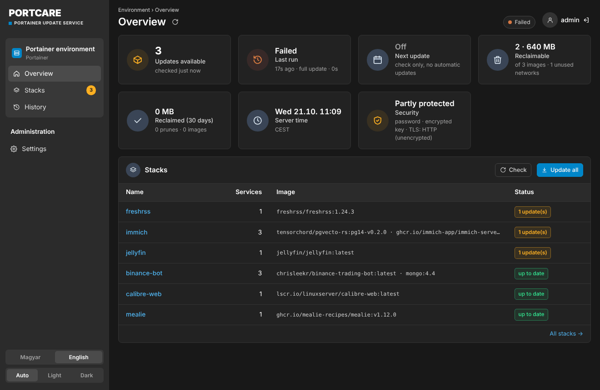
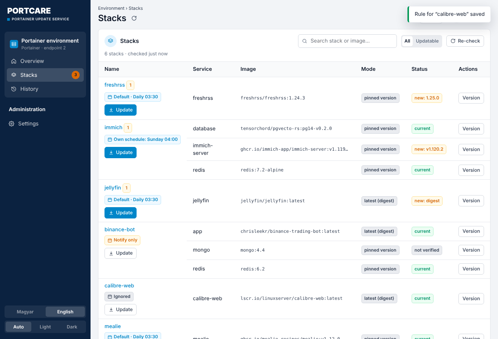
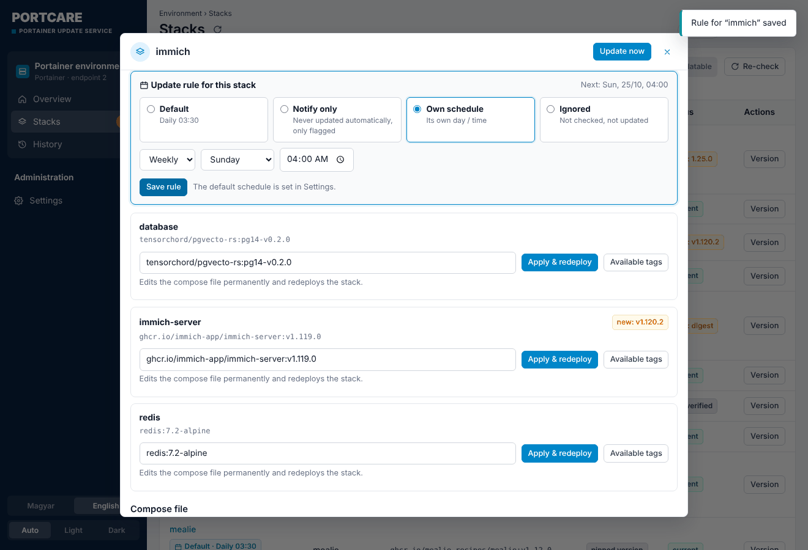
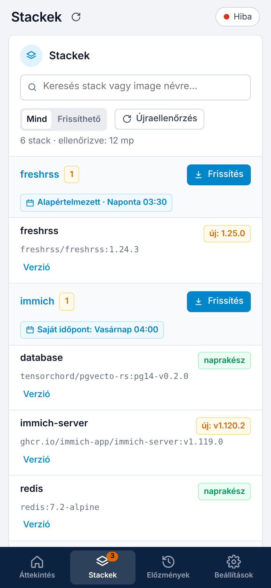
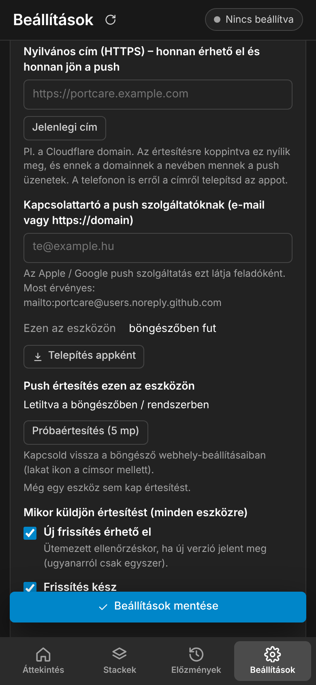
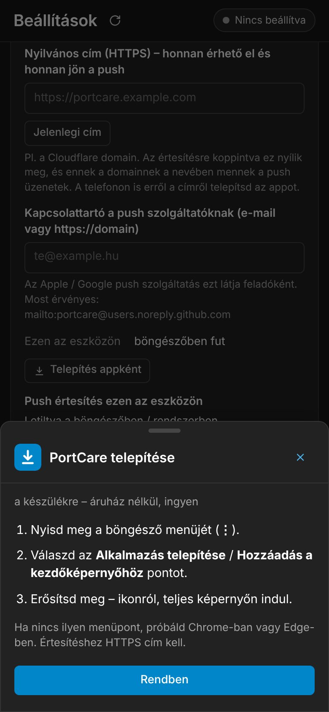

# PortCare – Portainer Update Service, localized and hardened

[Magyar](README.md) · **English**

A web UI that keeps your Portainer stacks up to date. It shows which images have a newer version and updates them on a schedule or by hand. Every run backs up Portainer first, a service can be pinned to a version in one click, and a broken update can be rolled back.

This is a fork of [joshmadison/Portainer-Update-Service](https://github.com/joshmadison/Portainer-Update-Service) (MIT). What's new:

- **Hungarian and English UI**, switchable in one click
- **Portainer-style look**: dark sidebar with an environment box, widget panels and tables, in a light and a dark theme
- **Light and dark theme**, following the system setting by default
- **Mobile layout**: bottom tab bar, card-style stack list, bottom sheet
- **Mandatory login**: viewing needs the password too, not just changes
- **Encrypted secrets**: the Portainer API key and the webhook URL are stored encrypted in `config.yaml`
- **TLS certificate pinning**: works with Portainer's self-signed certificate and with IP addresses
- **Optional scheduler**: "notify only" mode, you start the update yourself
- **Readable history**: every run shows what really got a new image, what was already current and what failed (with a hint); "Last updated" per stack, recent updates on the overview
- **"What's new" link**: one click from an update to the project's release notes (GitHub releases / Docker Hub)
- **Standalone containers too**: containers outside Portainer stacks (docker run, NAS apps) are checked and updated as well
- **Per-stack update rules**: default, notify only, own day/time, or ignored
- **Phone app (PWA) and push notifications**: installable on iPhone and Android, notifies about new updates, finished runs and failures
- **Everything is set in the web UI**: the stack's `PUS_*` variables only seed the initial defaults
- **Prebuilt image** for amd64 and arm64 (GHCR), nothing to build on the NAS

<p align="center">
  
</p>

| Stacks and update rules | Rule for one stack |
|---|---|
|  |  |

| Mobile: stacks | Mobile: app & push (HU) | Mobile: install guide (HU) |
|---|---|---|
|  |  |  |

---

## Install with Portainer

1. **Portainer → Stacks → Add stack → Web editor**, paste:

```yaml
services:
  update-service:
    image: ghcr.io/czdanika/portcare:latest
    container_name: portainer-update-service
    restart: unless-stopped
    ports:
      - "8742:8090"            # host port : container port
    environment:
      TZ: "Europe/Budapest"
      # Optional: the first admin password. If omitted, you create it in the UI on first start.
      # PUS_AUTH_TOKEN: "a-long-password"
    volumes:
      - pus-data:/app/data     # state, history, backups, encryption + push keys
      - pus-config:/app/config # settings (config.yaml)

volumes:
  pus-data:
  pus-config:
```

2. **Deploy the stack**, then open `http://<nas-ip>:8742`.
3. On first start, **create an admin password** (at least 8 characters), or sign in with `PUS_AUTH_TOKEN` if you set it.
4. **Settings → Portainer connection**:
   - URL: `https://<nas-ip>:9443`, or whatever address you open Portainer with in the browser (e.g. `http://<nas-ip>:8181/portainer`)
   - API key: Portainer → *My account* → *Access tokens* → *Add access token*. Create it with an admin user.
5. **Settings → TLS certificate** (https only): choose *Pin certificate*, press *Fetch certificate*, then *Pin this one*.
6. **Schedule**: the default is *Off – notify only*. For automatic updates, pick a day and time. Before that, set fragile stacks (databases, Immich, …) to *Notify only*.
7. **Save**. The first check starts automatically.

> The Docker socket is **not** mounted and not needed. Checks, backups, pruning and redeploys all go through the Portainer API. The socket is only needed to update Portainer itself (*Also update Portainer*), which is not recommended for security reasons.

### Updating PortCare

The image is rebuilt on every change to `main`. PortCare excludes its own stack from regular runs. Update it with **Settings → Update PortCare**, or in Portainer: *Stack → Update → Re-pull image*.

---

## Schedule and per-stack rules

- **Default schedule** (*Settings → Default schedule*): off (notify only), daily, weekly or every N hours. It applies to every stack that has no rule of its own.
- **Per-stack rule** (*Stacks* → the label under the stack name, or *Manage*):

| Rule | What it does |
|---|---|
| Default | Updated by the default schedule. |
| Notify only | Checked and flagged, but only updated by hand. |
| Own schedule | Updated on its own day and time (daily or weekly). |
| Ignored | Not checked, not updated. |

**"Update all"** redeploys stacks with the *Default* and *Own schedule* rules. *Notify only* and *Ignored* stacks are only updated with their own *Update* button.

### Standalone containers

The **Standalone containers** menu item shows containers that are not part of a Portainer stack (started with `docker run`, NAS apps, compose projects started elsewhere). Portainer's own container is left out.

- They are checked the same way and take the same rules, but they are **"Notify only" by default**.
- An update pulls the new image and recreates the container with Portainer's **Recreate** with the same settings, volumes and networks. On older Portainer versions PortCare does the same itself through the Docker API, and restores the old container if anything fails.
- Automatic runs only touch them when there really is a new image.

### Environment variables vs. the UI

`PUS_*` values in the stack **only seed the initial defaults**. Once you save a setting in the UI, the saved value wins. `PUS_AUTH_TOKEN` becomes the first admin password; afterwards the password is changed in the UI. Exceptions: `PUS_LISTEN_HOST` and `PUS_LISTEN_PORT` always come from the stack.

---

## Phone app and push notifications

PortCare can be installed as an app (PWA), without any app store:

- **iPhone / iPad (Safari):** *Share* → *Add to Home Screen* → *Add*.
- **Android (Chrome):** the UI offers an *Install* button, or menu (⋮) → *Install app*.
- In the UI: **Settings → Phone app & push notifications → Install as app**.

Push (standard Web Push, VAPID): **Settings → Phone app & push notifications → Enable**, per device. Three events can be switched:

- new update available (on a scheduled check, each set only once),
- update finished (with the list of updated stacks),
- update failed.

*Test notification* arrives after 5 seconds, so you can close the app in the meantime.

> **Important:** browsers only allow push and service workers on **HTTPS**. The local `http://192.168.x.x:8742` address is not enough. Two options:
> - **Cloudflare Tunnel**: e.g. `https://portcare.example.com` → `http://<nas-ip>:8742`. Login is mandatory, so this is fine; adding Cloudflare Access is recommended.
> - **Tailscale HTTPS**: `tailscale serve --bg 8742` on the NAS, then `https://<nas>.<tailnet>.ts.net`.
>
> On iPhone, notifications only work in the Home-Screen app (iOS 16.4 or later).

**Where push comes from:** *Settings → Phone app & push notifications* has two fields:

- **Public address**, e.g. `https://portcare.example.com`: tapping a notification opens this address, and pushes are sent on behalf of this domain. Install the phone app from this address too.
- **Contact**: e-mail or `https://domain`. Apple's and Google's push services see this as the sender. If empty, the public address's domain is used; if that is empty too, a neutral noreply address.

The VAPID key is created on first use in the `pus-data` volume (`keys/vapid_private.pem`); subscriptions are in `push.json`.

---

## Security

| Area | Solution |
|---|---|
| Login | Every `/api/*` call requires a login. The session is a signed, `HttpOnly`, `SameSite=Strict` cookie, valid for 30 days by default. Scripts can use `Authorization: Bearer <password>`. |
| Password | Stored as a PBKDF2 hash, never in plain text. `PUS_AUTH_TOKEN` only sets the first password. Changing the password invalidates other sessions. |
| Brute force | After 5 failed attempts, an exponentially growing lockout applies (max. 15 minutes). |
| CSRF | State-changing requests need a same-origin `Origin` and the `X-PUS-Request` header. |
| Secrets | `portainer_api_key` and `notify_webhook` are stored encrypted (`enc:v1:…`, Fernet/AES). The key lives in **another volume** (`/app/data/keys`) than `config.yaml` (`/app/config`). Old plain-text values are encrypted on the next save. `config.yaml` is `0600`. |
| Environment variables | `PUS_*` values are initial defaults only. They are not written to `config.yaml` until you change them in the UI. |
| TLS | Certificate pinning (SHA-256 fingerprint) works with self-signed certificates and IP addresses. If the certificate changes, the connection fails and the UI says so. Upstream bug fixed: `tls_verify: true` without a CA did *not* actually verify. |

Recommendation: don't expose the UI to the internet without extra protection. A LAN or VPN (e.g. Tailscale) is enough.

### Encryption key

Created on first start at `/app/data/keys/secret.key`. If the `pus-data` volume is lost, re-enter the saved API key (the UI tells you). `PUS_SECRET_KEY` sets a fixed key instead.

---

## Environment variables

| Variable | Default | Description |
|---|---|---|
| `PUS_AUTH_TOKEN` / `PUS_ADMIN_PASSWORD` | – | The first admin password. Can be changed in the UI afterwards. |
| `PUS_RESET_PASSWORD` | – | Forgot the password? Set to `true`: on start, `PUS_AUTH_TOKEN` becomes the new password. Remove the line afterwards. |
| `PUS_SECRET_KEY` | automatic | Encryption key (any string). |
| `PUS_PORTAINER_URL` | – | Portainer address (also set in the UI). |
| `PUS_PORTAINER_API_KEY` | – | Portainer API key (also set in the UI). |
| `PUS_PORTAINER_ENDPOINT_ID` | automatic | Portainer environment ID. |
| `PUS_TLS_FINGERPRINT` | – | SHA-256 fingerprint of Portainer's certificate. |
| `PUS_UPDATE_SCHEDULE_MODE` | `off` | `off` (notify only), `daily`, `weekly` or `interval`. |
| `PUS_UPDATE_SCHEDULE_DAY` / `_TIME` | `0` / `03:30` | Day (0 = Monday) and time. |
| `PUS_UPDATE_INTERVAL_HOURS` | `168` | Interval between updates in `interval` mode. |
| `PUS_CHECK_INTERVAL_HOURS` | `12` | How often to check the registries. |
| `PUS_NOTIFY_WEBHOOK` | – | Notification URL (JSON POST). |
| `PUS_NOTIFY_ON_UPDATES` | `false` | Also send the webhook for new updates. |
| `PUS_MAX_PARALLEL_DEPLOYS` | `3` | How many stacks are redeployed at once. |
| `PUS_KEEP_BACKUPS` | `5` | Number of Portainer backups to keep. |
| `PUS_PUBLIC_URL` | – | Public HTTPS address: notification link and push sender (also set in the UI). |
| `PUS_NOTIFY_CONTACT` | – | Contact for the push services (e-mail or `https://domain`, also set in the UI). |
| `PUS_SESSION_DAYS` | `30` | Login lifetime in days. |
| `PUS_COOKIE_SECURE` | `false` | `true` if the UI is served over HTTPS only (behind a reverse proxy). |
| `TZ` | `UTC` | Time zone for the schedule. |

### Webhook format

```json
{"event": "updates_available", "title": "3 container update(s) available", "count": 3,
 "updates": [{"stack": "immich", "service": "immich-server", "image": "…:v1.119.0", "latest": "v1.120.2"}]}
```

```json
{"event": "update_failed", "title": "Portainer update run FAILED", "run_id": "…", "steps": […]}
```

In Home Assistant, an automation with a **Webhook** trigger receives it at `https://<ha>/api/webhook/<id>`; forward `{{ trigger.json.title }}` as a notification.

---

## Development

```bash
pip install -r requirements.txt pytest pytest-timeout
python -m pytest tests -q
PUS_LISTEN_HOST=127.0.0.1 python run.py   # http://127.0.0.1:8090
```

## License

MIT. Original author: Josh Madison ([upstream README](docs/UPSTREAM_README.md)). Changes are released under the same license.
