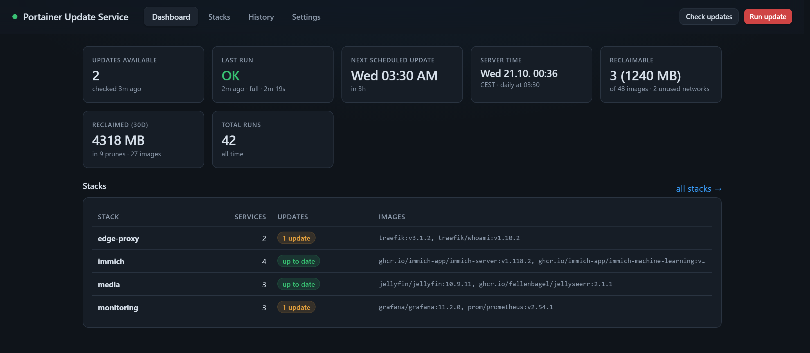
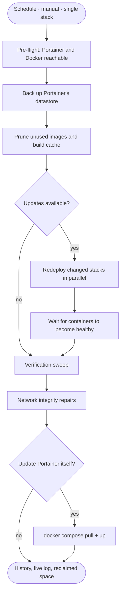
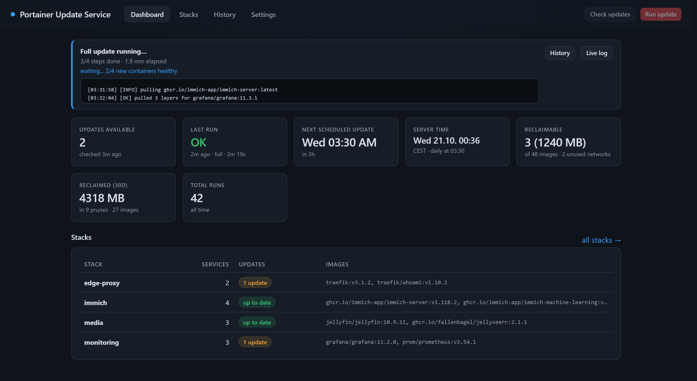
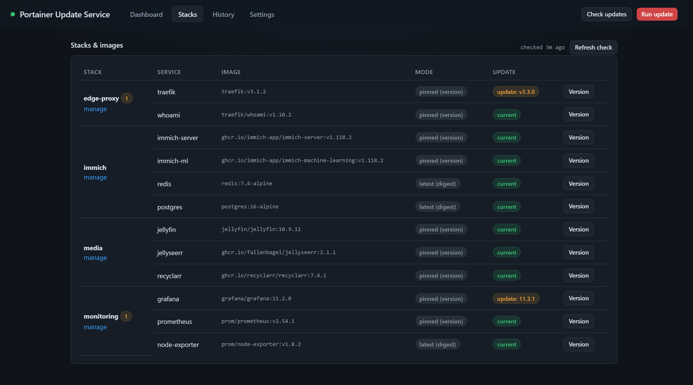
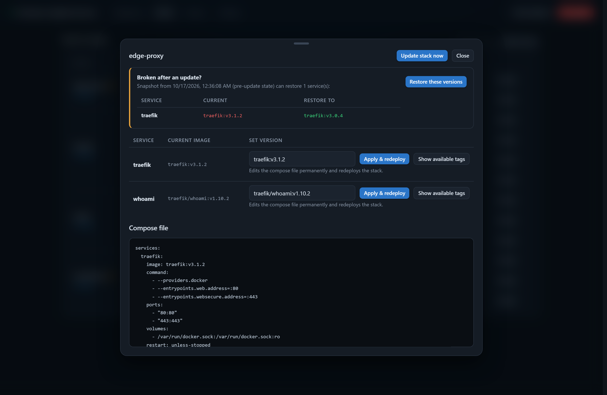
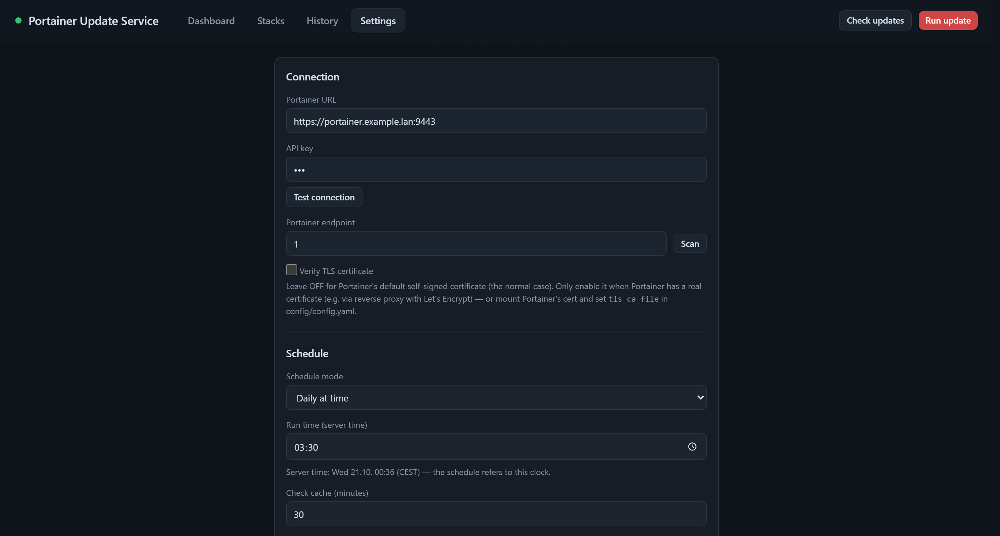
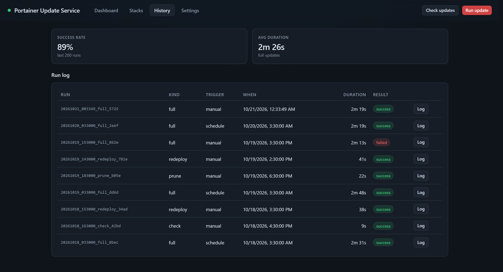

# Portainer Update Service

**Pull. Redeploy. Done.**

Keep every Portainer stack on current images without opening Portainer. This
service checks your stacks against their registries, redeploys only what
changed, backs up first, cleans up after itself, and keeps a readable record of
every run. Self-hosted — no accounts, no cloud, no telemetry.

[](https://github.com/joshmadison/Portainer-Update-Service/actions/workflows/ci.yml)
[](LICENSE)
[](https://www.python.org/)
[](https://www.docker.com/)

<p align="center">
  
</p>
<p align="center">
  <sub>One page answers the only three questions that matter: what changed, when did it last run, when does it run next.</sub>
</p>

## Features

- **Per-service checks, not stack guessing.** Every compose service's image is
  resolved and compared against docker.io and ghcr.io — by tag or digest,
  whichever the reference uses. The badge tells you how long the update has
  been out. Registries that can't be read anonymously are shown as *not
  verified* instead of being guessed at.
- **Scheduled runs you can trust.** Interval, daily or weekly, in the
  container's timezone. Manual runs any time. Repeated failures back off
  instead of hammering your host.
- **Backup → update → verify → repair.** Portainer's datastore is backed up
  before anything changes (a failed backup is recorded and the run carries on),
  unused images and build cache are pruned, changed stacks redeploy in parallel
  and wait until their containers are healthy, then a verification sweep and
  network repairs run.
- **Rollback to the last healthy version.** Pre-update images are snapshotted
  per stack, so a bad release is one click away from being undone.
- **Version pinning with real tags.** Pin a service to a specific tag (or move
  it back to `latest`) and the compose file is edited in Portainer and the
  stack redeployed — no copy-pasting YAML.
- **Cleanup with restraint.** Only unused images and build cache are removed.
  Stopped containers and their networks stay: they encode your intent.
- **A history that answers questions.** Steps, duration, live log, success
  rate and 30-day reclaimed space.
- **Local by design.** The app talks to your Portainer and the registries you
  already use. Nothing else.

## How it works



While a run is active the dashboard shows the current phase, step progress and
the tail of the log, so you can see what it is doing without leaving the page.

<p align="center">
  
</p>
<p align="center">
  <sub>A run in progress: phase, elapsed time and the last log lines, live.</sub>
</p>

## Requirements

- A running **Portainer** instance
- A Portainer **API key with admin rights** — *Settings → API keys → Add API key*

The key needs admin rights because pruning and backups are admin-only
endpoints. Portainer may use a self-signed certificate; the service expects
that by default.

## Quick start

### Option A — as a Portainer stack (recommended)

1. **Stacks → Add stack → Repository**
2. Repository URL: `https://github.com/joshmadison/Portainer-Update-Service`
   Build method **Dockerfile**, compose path `docker-compose.yml`
3. Add these environment variables (only the first is required):

   | Variable | Value | Why |
   |---|---|---|
   | `PUS_LISTEN_HOST` | `0.0.0.0` | Required inside a container |
   | `TZ` | e.g. `Europe/Berlin` | Timezone the schedule refers to |
   | `PUS_AUTH_TOKEN` | e.g. `change-me` | **Recommended** — protects the UI/API |

4. **Deploy the stack**, then open `http://<host>:8090`
5. In **Settings**: enter the Portainer URL, paste the API key, **Test
   connection**, **Save**. The first update check starts by itself.

Settings are written to `config/config.yaml` in the config volume and survive
redeploys.

### Option B — docker compose

```bash
git clone https://github.com/joshmadison/Portainer-Update-Service.git
cd Portainer-Update-Service
docker compose up -d --build
# open http://localhost:8090 and finish setup in Settings
```

The shipped compose file leaves the credentials empty on purpose: configure
them in the UI, or uncomment `PUS_PORTAINER_URL` / `PUS_PORTAINER_API_KEY`.
Environment variables win over settings made in the UI.

### Option C — local Python

```bash
python -m venv .venv
.venv/Scripts/pip install -r requirements.txt   # Windows
.venv/bin/pip install -r requirements.txt       # Linux / macOS

.venv/Scripts/python run.py                      # Windows
.venv/bin/python run.py                          # Linux / macOS
# open http://127.0.0.1:8090
```

> [!NOTE]
> The Docker socket is **optional**. Checks, backups, pruning and stack
> redeploys all go through Portainer's API. Only *updating Portainer itself*
> needs the socket (and Portainer's compose directory mounted read-only).

## Using it

**Stacks** is where the per-service truth lives: image, how it's tracked
(pinned version, digest, …), and whether it's current.

<p align="center">
  
</p>

**Run update** performs the whole sequence. **Check updates** only refreshes the
badges. One job runs at a time — if something is already going, the app says
so instead of queueing silently.

Open any stack to see its compose file, pin a version, redeploy it alone, or
roll it back.

## Versions and rollback

The sheet behind each stack is also the recovery path. The snapshot strip at the
top shows exactly what a rollback would change, and restoring is a single
button.

<p align="center">
  
</p>
<p align="center">
  <sub>Pin a version, redeploy one stack, or restore the images from before the last update.</sub>
</p>

## Schedule and settings

<p align="center">
  
</p>

**Schedule mode** offers `interval` (every N hours), `daily` and `weekly` (at
`HH:MM` in the container's timezone). **Deploy wait time** caps how long each
redeploy waits for its containers to report healthy. Everything is validated
before it is saved — and if an environment variable exists for a key, it wins.

## History

<p align="center">
  
</p>

Every run — scheduled, manual, redeploy, prune, rollback, self-update — is
recorded with its steps, duration and full log. Reclaimed space is aggregated
over the last 30 days.

## Configuration

Most people never touch a config file: the UI covers everything and writes
`config/config.yaml` in the mounted config volume. The committed template is
[`config/config.example.yaml`](config/config.example.yaml), including the
optional custom repair rules.

Every key can also be set as an environment variable with the `PUS_` prefix
(`portainer_url` → `PUS_PORTAINER_URL`), which is handy for stacks deployed
from Git.

| Variable | Default | What it does |
|---|---|---|
| `PUS_PORTAINER_URL` | — | Portainer base URL |
| `PUS_PORTAINER_API_KEY` | — | Portainer API key (admin) |
| `PUS_PORTAINER_ENDPOINT_ID` | auto | Pin an endpoint if auto-detect picks the wrong one |
| `PUS_LISTEN_HOST` | `127.0.0.1` | Bind address — **must be `0.0.0.0` in a container** |
| `PUS_LISTEN_PORT` | `8090` | Web UI port |
| `PUS_AUTH_TOKEN` | — | If set, mutating API calls need `Authorization: Bearer <token>` |
| `PUS_UPDATE_SCHEDULE_MODE` | `interval` | `interval`, `daily` or `weekly` |
| `PUS_UPDATE_INTERVAL_HOURS` | `168` | Interval mode: hours between runs |
| `PUS_UPDATE_SCHEDULE_TIME` | `03:30` | Daily/weekly run time, `HH:MM` |
| `PUS_UPDATE_SCHEDULE_DAY` | `0` | Weekly mode: `0` = Monday … `6` = Sunday |
| `PUS_TLS_VERIFY` | `false` | Verify Portainer's TLS certificate |
| `PUS_TLS_CA_FILE` | — | Path to a CA/cert to verify a self-signed Portainer cert |
| `PUS_MAX_PARALLEL_DEPLOYS` | `3` | Stacks redeployed at once |
| `PUS_DEPLOY_WAIT_TIME` | `300` | Seconds to wait for containers to become healthy |
| `PUS_KEEP_BACKUPS` | `5` | Portainer backups to keep |
| `PUS_CHECK_CACHE_MINUTES` | `30` | Registry result cache TTL (respects rate limits) |
| `PUS_NOTIFY_WEBHOOK` | — | POST a JSON summary here when a run fails (ntfy-compatible) |
| `PUS_INCLUDE_PORTAINER` | `false` | Also update Portainer itself (see below) |
| `PUS_REPAIRS_ENABLED` | `true` | Automatic network integrity repairs |

## Updating Portainer itself (optional)

Portainer is usually started outside Portainer, so updating it needs two extra
mounts in this app's stack:

```yaml
    volumes:
      - /path/to/portainer:/host-portainer:ro          # Portainer's compose dir
      - /var/run/docker.sock:/var/run/docker.sock      # for docker compose
```

Enable **Include Portainer updates** in Settings and press **Check compose
mount** to verify the wiring. A full run then ends with `docker compose pull &&
docker compose up -d` in that directory — after everything else has finished,
so the update doesn't cut its own run short.

The app's own stack is excluded from regular runs for the same reason. Use
**Update P.U.S.** in Settings when you want to move it forward deliberately.

## Security

> [!WARNING]
> The UI has **no login**. If it is reachable from other machines, set
> `auth_token` (or `PUS_AUTH_TOKEN`) — that protects every mutating endpoint —
> or put an authenticated reverse proxy in front.

- Mutating requests are also CSRF-guarded when no token is configured: a
  cross-site form post cannot trigger an update.
- The API key is stored in `config.yaml`, never returned by the API, and never
  committed.
- `tls_verify: false` accepts Portainer's default self-signed certificate. If
  Portainer has a real certificate, turn verification on; if it is self-signed,
  mount its certificate and point `tls_ca_file` at it.
- No telemetry, no analytics, no outbound calls except to your Portainer and the
  image registries.

## API

Every UI action is an API call, so scripts and dashboards can use it too.

| Method | Path | Description |
|---|---|---|
| `GET` | `/api/status` | State, last run, current job, next run |
| `GET` | `/api/stacks` | Stacks with per-service check results |
| `GET` | `/api/stacks/<id>` | Stack detail and compose file |
| `POST` | `/api/stacks/<id>/image` | Pin a version: `{"service":"web","image":"nginx:1.27.3"}` |
| `POST` | `/api/stacks/<id>/redeploy` | Redeploy one stack |
| `GET` | `/api/stacks/<id>/rollback_info` | What a rollback would change |
| `POST` | `/api/stacks/<id>/rollback` | Restore a stack's pre-update images |
| `POST` | `/api/check` | Force an update check |
| `POST` | `/api/update` | Start a full update run |
| `POST` | `/api/prune` | Prune images and build cache now |
| `POST` | `/api/self_update` | Redeploy this app's own stack |
| `GET` | `/api/inventory` | Unused images and networks |
| `GET` | `/api/runs/current` | Live progress of the active job |
| `GET` | `/api/runs/<id>/log` | Full run log (plain text) |
| `GET` | `/api/history` | Recent runs and 30-day prune stats |
| `GET` | `/api/versions?image=nginx` | Available tags for an image |
| `GET` | `/api/endpoints` | Portainer endpoints |
| `GET`/`POST` | `/api/settings` | Read or change settings |
| `GET` | `/healthz` | Liveness and scheduler heartbeat |

```bash
curl -X POST -H "Authorization: Bearer $TOKEN" \
     https://your-host:8090/api/update
```

## Development

```bash
pip install -r requirements.txt pytest pytest-timeout
python -m pytest tests/ -q
# 119 passed
```

The UI is a single `ui/index.html` — no build step, no dependencies. CI runs
the test suite plus four cheap gates that catch the failures a build step would
have caught: import, byte-compile, JS syntax (via `dukpy`) and duplicate HTML
ids.

## Project layout

```
app/                    Python package
  main.py               Flask API + static UI
  updater.py            the update run (backup, prune, redeploy, verify, repair)
  checker.py            per-service update checks
  dockerhub.py          docker.io / ghcr.io tag and digest lookups
  snapshots.py          pre-update image snapshots (rollback)
  compose.py            compose file helpers (image parsing, pinning)
  portainer.py          Portainer API client
  scheduler.py          interval / daily / weekly scheduling
  history.py            run history, logs, reclaimed-space stats
  jobs.py               single-job gate
  config.py             config loading, validation, persistence
ui/index.html           the web UI (single file, no build step)
config/config.example.yaml
docs/screenshots/       the images in this README
tests/                  pytest suite
docker-compose.yml
Dockerfile
run.py                  entry point
```

## License

MIT — see [LICENSE](LICENSE).
