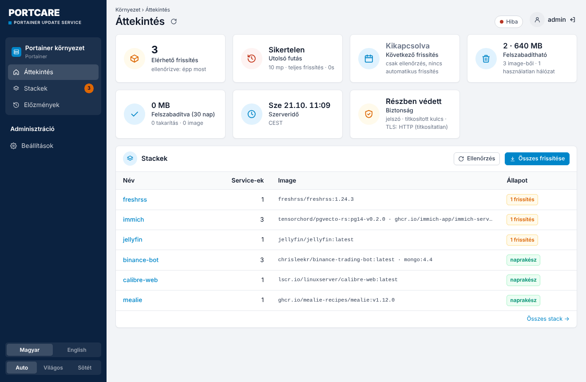
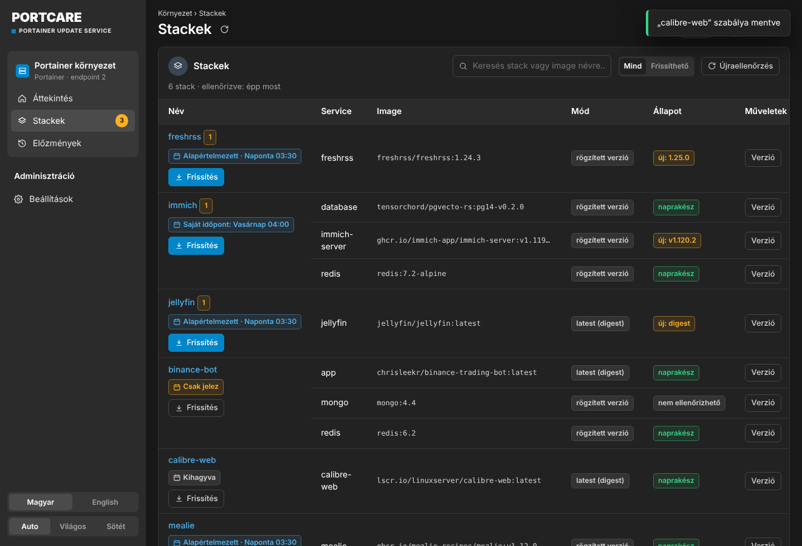
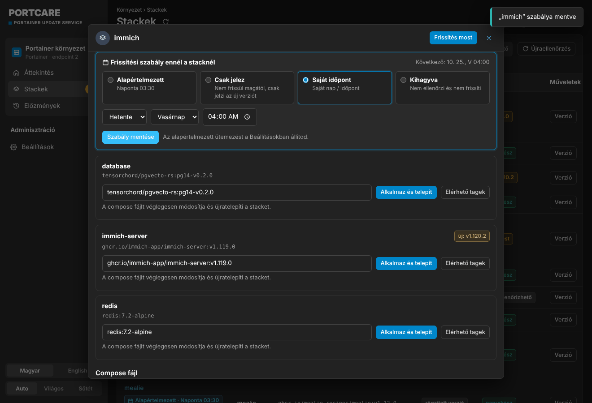
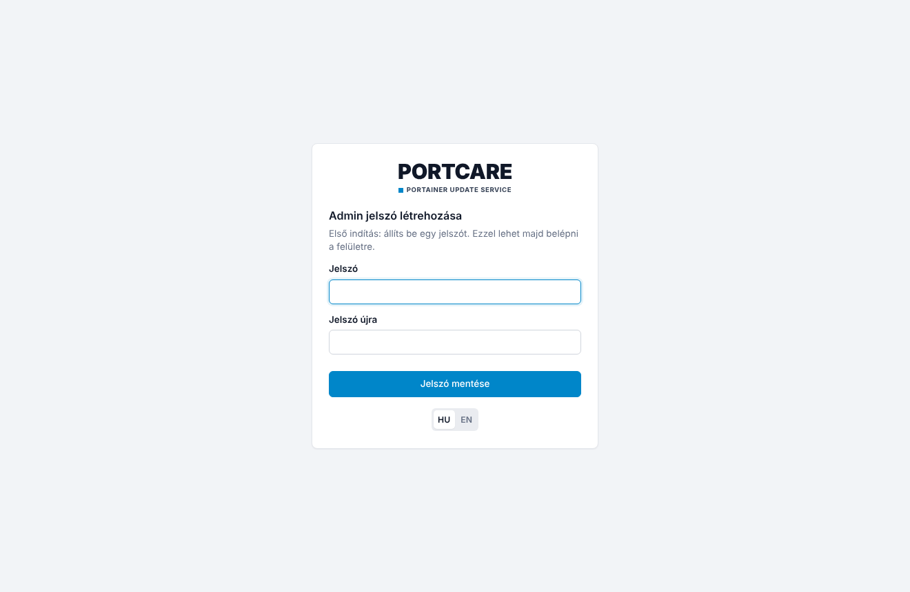

# PortCare – Portainer Update Service, magyarul és biztonságosabban

**Magyar** · [English](README.en.md)

Webes felület a Portainer stackek frissítéséhez. Megmutatja, melyik image-hez jelent meg újabb verzió, és ütemezve vagy kézzel frissít. Minden futás előtt lementi a Portainert, egy service verzióját egy kattintással rögzítheted, egy elromlott frissítés után pedig visszaállhatsz.

Ez a [joshmadison/Portainer-Update-Service](https://github.com/joshmadison/Portainer-Update-Service) (MIT) forkja. Ami benne új:

- **Magyar és angol felület**, egy kattintással váltható (alapból magyar)
- **Portainer-szerű kinézet**: sötét oldalsáv környezet-blokkal, „widget” panelek, táblázatok – világos és sötét témában
- **Mobilnézet**: alsó menüsor, kártyás stacklista, alulról felcsúszó panel
- **Világos és sötét téma**, alapból a rendszer beállítását követi
- **Kötelező bejelentkezés**: nem csak a módosításokhoz, hanem a megtekintéshez is jelszó kell
- **Titkosított titkok**: a Portainer API kulcs és a webhook URL titkosítva kerül a `config.yaml`-ba
- **TLS-tanúsítvány rögzítése** (pinning): a Portainer saját aláírású tanúsítványával és IP-címmel is működik
- **Kikapcsolható ütemező**: „csak jelez” mód, a frissítést te indítod
- **Érthető előzmények**: minden futásnál látszik, mi kapott ténylegesen új image-et, mi volt már naprakész és mi hibázott (tippel együtt); stackenként „Utoljára frissítve”, az áttekintőn a legutóbbi frissítések
- **„Újdonságok” link**: frissítésnél egy kattintással a projekt kiadási jegyzeteihez (GitHub releases / Docker Hub)
- **Önálló konténerek is**: a Portainer stacken kívül futó konténereket (docker run, NAS-alkalmazások) is ellenőrzi és frissíti
- **Stackenkénti frissítési szabály**: alapértelmezett, csak jelez, saját nap/időpont vagy kihagyva
- **Telefonos app (PWA) és push értesítés**: iPhone-ra és Androidra telepíthető, értesít az új frissítésekről, a frissítés végén és hibánál
- **Minden a webes felületről állítható**: a stack `PUS_*` változói csak első induláskor adnak alapértéket
- **Értesítés új frissítésekről**, nem csak hibáról (pl. Home Assistant webhookra)
- **Előre megépített image** amd64-re és arm64-re (GHCR), a NAS-on nem kell semmit buildelni

<p align="center">
  
</p>

| Stackek és frissítési szabályok | Szabály egy stackre |
|---|---|
|  |  |

| Mobil: stackek | Mobil: app és push | Mobil: telepítés | Belépés |
|---|---|---|---|
|  |  |  |  |

---

## Telepítés Portainerrel

1. **Portainer → Stacks → Add stack → Web editor**, másold be ezt:

```yaml
services:
  update-service:
    image: ghcr.io/czdanika/portcare:latest
    container_name: portainer-update-service
    restart: unless-stopped
    ports:
      - "8742:8090"            # NAS-port : konténer-port
    environment:
      TZ: "Europe/Budapest"
      # Opcionális: az első admin jelszó. Ha kihagyod, első indításkor a felületen adod meg.
      # PUS_AUTH_TOKEN: "egy-hosszu-jelszo"
    volumes:
      - pus-data:/app/data     # állapot, előzmények, mentések, titkosító kulcs
      - pus-config:/app/config # beállítások (config.yaml)

volumes:
  pus-data:
  pus-config:
```

2. **Deploy the stack**, majd nyisd meg a `http://<nas-ip>:8742` címet.
3. Első indításkor **admin jelszót** kell létrehozni (legalább 8 karakter), vagy ha megadtad a `PUS_AUTH_TOKEN`-t, azzal lépsz be.
4. **Beállítások → Portainer kapcsolat**:
   - URL: `https://<nas-ip>:9443`, vagy amin a Portainert a böngészőben megnyitod (pl. `http://<nas-ip>:8181/portainer`)
   - API kulcs: Portainer → *My account* → *Access tokens* → *Add access token*. Admin felhasználóval kell létrehozni.
5. **Beállítások → TLS tanúsítvány**: válaszd a *Tanúsítvány rögzítése* módot, nyomd meg a *Tanúsítvány lekérése* gombot, aztán az *Ezt rögzítem* gombot.
6. **Ütemezés**: az alapbeállítás *Kikapcsolva – csak jelez*. Ha automatikus frissítést szeretnél, válassz napot és időpontot. Előtte a törékeny service-eket (adatbázisok, Immich stb.) rögzítsd a *Verzió* gombbal.
7. **Mentés**. Az első ellenőrzés automatikusan elindul.

> A Docker socket **nincs** felcsatolva, és nem is kell. Az ellenőrzés, a mentés, a takarítás és az újratelepítés mind a Portainer API-n keresztül megy. Socket csak akkor kell, ha a Portainert is ezzel akarod frissíteni (*A Portainert is frissítse*), de ezt biztonsági okból nem ajánljuk.

### Frissítés

Az image a `main` ág minden változásakor újraépül. A PortCare a saját stackjét kihagyja a rendes futásokból. Frissíteni a **Beállítások → PortCare frissítése** gombbal lehet, vagy a Portainerben: *Stack → Update → Re-pull image*.

Ha egy konkrét verziót szeretnél használni, a `:latest` helyett írd be a kiadás címkéjét, például `:v1.0.0`.

---

## Ütemezés és stackenkénti szabályok

- **Alapértelmezett ütemezés** (*Beállítások → Alapértelmezett ütemezés*): kikapcsolva (csak jelez), naponta, hetente vagy N óránként. Ez minden olyan stackre vonatkozik, amelynek nincs saját szabálya.
- **Stackenkénti szabály** (*Stackek* → a stack neve alatti címke, vagy *Kezelés*):

| Szabály | Mit csinál |
|---|---|
| Alapértelmezett | Az alapértelmezett ütemezéssel frissül. |
| Csak jelez | Ellenőrzi és jelzi az új verziót, de csak kézzel frissül. |
| Saját időpont | Saját napon és időpontban frissül (naponta vagy hetente). |
| Kihagyva | Nem ellenőrzi és nem frissíti. |

Az **„Összes frissítése”** gomb az *Alapértelmezett* és a *Saját időpont* szabályú stackeket frissíti. A *Csak jelez* és a *Kihagyva* szabályú stackek csak a saját *Frissítés* gombjukkal frissülnek.

### Önálló konténerek

Az oldalsáv **Önálló konténerek** menüpontja mutatja azokat a konténereket, amelyek nem Portainer stackhez tartoznak (pl. `docker run`-nal indítottak, NAS-alkalmazások, máshol indított compose projektek). A Portainer saját konténere kimarad.

- Ugyanúgy ellenőrzi őket, és ugyanazok a szabályok állíthatók rájuk, de **alapból „Csak jelez”** módban vannak.
- Frissítéskor letölti az új image-et, és a Portainer **Recreate** funkciójával ugyanazokkal a beállításokkal, kötetekkel és hálózatokkal hozza létre újra a konténert. Régebbi Portainernél ugyanezt maga végzi el a Docker API-n keresztül, és hiba esetén visszaállítja a régi konténert.
- Automatikus futásban csak akkor nyúl hozzá, ha tényleg van új image.

### Környezeti változók és a felület

A stackben megadott `PUS_*` értékek **csak első induláskor** számítanak alapértéknek. Amint egy beállítást a felületen elmentesz, onnantól a mentett érték az irányadó. A `PUS_AUTH_TOKEN` az első admin jelszó lesz, utána a jelszót a felületen lehet megváltoztatni. Kivétel a `PUS_LISTEN_HOST` és a `PUS_LISTEN_PORT`: ezek mindig a stackből jönnek.

---

## Telefonos app és push értesítés

A PortCare telepíthető appként (PWA), App Store vagy Play Áruház nélkül:

- **iPhone / iPad (Safari):** *Megosztás* → *Főképernyőhöz adás* → *Hozzáadás*.
- **Android (Chrome):** a felület felajánlja a *Telepítés* gombot, vagy menü (⋮) → *Alkalmazás telepítése*.
- A felületen: **Beállítások → Telefonos app és push értesítés → Telepítés appként**.

Push értesítés (szabványos Web Push, VAPID): **Beállítások → Telefonos app és push értesítés → Engedélyezés**, eszközönként. Három esemény kapcsolható:

- új frissítés érhető el (ütemezett ellenőrzéskor, ugyanarról csak egyszer),
- a frissítés lefutott (a frissített stackek listájával),
- a frissítés sikertelen.

A *Próbaértesítés* 5 másodperc múlva érkezik, közben be lehet zárni az appot.

> **Fontos:** a böngészők csak **HTTPS** kapcsolaton engedik a push értesítést és a service workert. A helyi `http://192.168.x.x:8742` cím ehhez nem elég. Két lehetőség:
> - **Cloudflare Tunnel**: például `https://portcare.example.com` → `http://<nas-ip>:8742`. A belépés kötelező, ezért ez is biztonságos, de érdemes Cloudflare Access-szel is védeni.
> - **Tailscale HTTPS**: `tailscale serve --bg 8742` a NAS-on, majd `https://<nas>.<tailnet>.ts.net`.
>
> iPhone-on az értesítés csak a főképernyőre telepített appban működik (iOS 16.4 vagy újabb).

**Honnan jön a push:** a *Beállítások → Telefonos app és push értesítés* részben két mező van:

- **Nyilvános cím**, például `https://portcare.example.com`: az értesítésre koppintva ez nyílik meg, és ennek a domainnek a nevében mennek az üzenetek. Az appot a telefonon is erről a címről telepítsd.
- **Kapcsolattartó**: e-mail vagy `https://domain`. Az Apple és a Google push szolgáltatása ezt látja feladóként. Ha üres, a nyilvános cím domainje lesz, ha az is üres, egy semleges noreply cím.

A VAPID kulcs első használatkor jön létre a `pus-data` kötetben (`keys/vapid_private.pem`), a feliratkozások a `push.json` fájlban vannak.

---

## Biztonság

| Terület | Megoldás |
|---|---|
| Bejelentkezés | Minden `/api/*` hívás bejelentkezést kér. A munkamenet aláírt, `HttpOnly`, `SameSite=Strict` süti, alapból 30 napig érvényes. Szkriptekből `Authorization: Bearer <jelszó>` fejléccel is hívható. |
| Jelszó | PBKDF2-hash-ként tárolódik, sima szövegként soha. A `PUS_AUTH_TOKEN` csak az első jelszót adja meg. Jelszócsere után a többi munkamenet érvénytelenné válik. |
| Brute force | 5 hibás próbálkozás után exponenciálisan növekvő várakozás következik (legfeljebb 15 perc). |
| CSRF | A módosító kéréseknél kötelező az azonos eredetű `Origin` és az `X-PUS-Request` fejléc. |
| Titkok | A `portainer_api_key` és a `notify_webhook` titkosítva tárolódik (`enc:v1:…`, Fernet/AES). A kulcs **másik kötetben** van (`/app/data/keys`), mint a `config.yaml` (`/app/config`). A régi, sima szöveges értékeket első mentéskor automatikusan titkosítja. A `config.yaml` jogosultsága `0600`. |
| Környezeti változók | A `PUS_*` értékek csak kezdő alapértékek. Amíg a felületen nem változtatod meg őket, nem íródnak a `config.yaml`-ba. |
| TLS | A tanúsítvány rögzítése (SHA-256 ujjlenyomat) saját aláírású tanúsítvánnyal és IP-címmel is működik. Ha a tanúsítvány megváltozik, a kapcsolat megszakad, és a felület jelzi. Az eredeti kódban volt egy hiba: `tls_verify: true` CA nélkül valójában *nem* ellenőrzött. Ez javítva van. |

További ajánlás: a felületet ne tedd ki az internetre. Elég belső hálón vagy VPN-en (pl. Tailscale) keresztül elérni.

### Titkosító kulcs

Alapból az első induláskor jön létre a `/app/data/keys/secret.key` fájlban. Ha a `pus-data` kötet elveszik, a mentett API kulcsot újra meg kell adni (a felület jelzi). A `PUS_SECRET_KEY` változóval fix kulcs is megadható.

---

## Környezeti változók

| Változó | Alapérték | Leírás |
|---|---|---|
| `PUS_AUTH_TOKEN` / `PUS_ADMIN_PASSWORD` | – | Az első admin jelszó. Utána a felületen módosítható. |
| `PUS_RESET_PASSWORD` | – | Elfelejtett jelszó esetén `true`: induláskor a `PUS_AUTH_TOKEN` lesz az új jelszó. Utána vedd ki a sort. |
| `PUS_SECRET_KEY` | automatikus | A titkosító kulcs (tetszőleges szöveg). |
| `PUS_PORTAINER_URL` | – | Portainer címe (a felületen is megadható). |
| `PUS_PORTAINER_API_KEY` | – | Portainer API kulcs (a felületen is megadható). |
| `PUS_PORTAINER_ENDPOINT_ID` | automatikus | Portainer környezet azonosítója. |
| `PUS_TLS_FINGERPRINT` | – | A Portainer tanúsítványának SHA-256 ujjlenyomata. |
| `PUS_UPDATE_SCHEDULE_MODE` | `off` | `off` (csak jelez), `daily`, `weekly` vagy `interval`. |
| `PUS_UPDATE_SCHEDULE_DAY` / `_TIME` | `0` / `03:30` | Nap (0 = hétfő) és időpont. |
| `PUS_UPDATE_INTERVAL_HOURS` | `168` | `interval` módban a frissítések közti idő. |
| `PUS_CHECK_INTERVAL_HOURS` | `12` | Milyen gyakran ellenőrizze a registryt. |
| `PUS_NOTIFY_WEBHOOK` | – | Értesítési URL (JSON POST). |
| `PUS_NOTIFY_ON_UPDATES` | `false` | Új frissítésnél is küldjön értesítést. |
| `PUS_MAX_PARALLEL_DEPLOYS` | `3` | Egyszerre hány stack települjön újra. |
| `PUS_KEEP_BACKUPS` | `5` | Ennyi Portainer-mentést tart meg. |
| `PUS_PUBLIC_URL` | – | Nyilvános HTTPS cím: az értesítések linkje és a push feladója (a felületen állítható). |
| `PUS_NOTIFY_CONTACT` | – | Kapcsolattartó a push szolgáltatóknak (e-mail vagy `https://domain`, a felületen állítható). |
| `PUS_SESSION_DAYS` | `30` | A bejelentkezés érvényessége napokban. |
| `PUS_COOKIE_SECURE` | `false` | `true`, ha a felület csak HTTPS-en érhető el (reverse proxy mögött). |
| `TZ` | `UTC` | Időzóna az ütemezéshez. |

### Webhook formátum

```json
{"event": "updates_available", "title": "3 container update(s) available", "count": 3,
 "updates": [{"stack": "immich", "service": "immich-server", "image": "…:v1.119.0", "latest": "v1.120.2"}]}
```

```json
{"event": "update_failed", "title": "Portainer update run FAILED", "run_id": "…", "steps": […]}
```

Home Assistantban egy **Webhook** triggerű automatizáció fogadja: `https://<ha>/api/webhook/<id>`. A `{{ trigger.json.title }}` sablonnal továbbküldhető push értesítésként.

---

## Fejlesztés

```bash
pip install -r requirements.txt pytest pytest-timeout
python -m pytest tests -q
PUS_LISTEN_HOST=127.0.0.1 python run.py   # http://127.0.0.1:8090
```

## Licenc

MIT. Az eredeti szerző: Josh Madison ([upstream README](docs/UPSTREAM_README.md)). A módosítások ugyanezen licenc alatt érhetők el.
