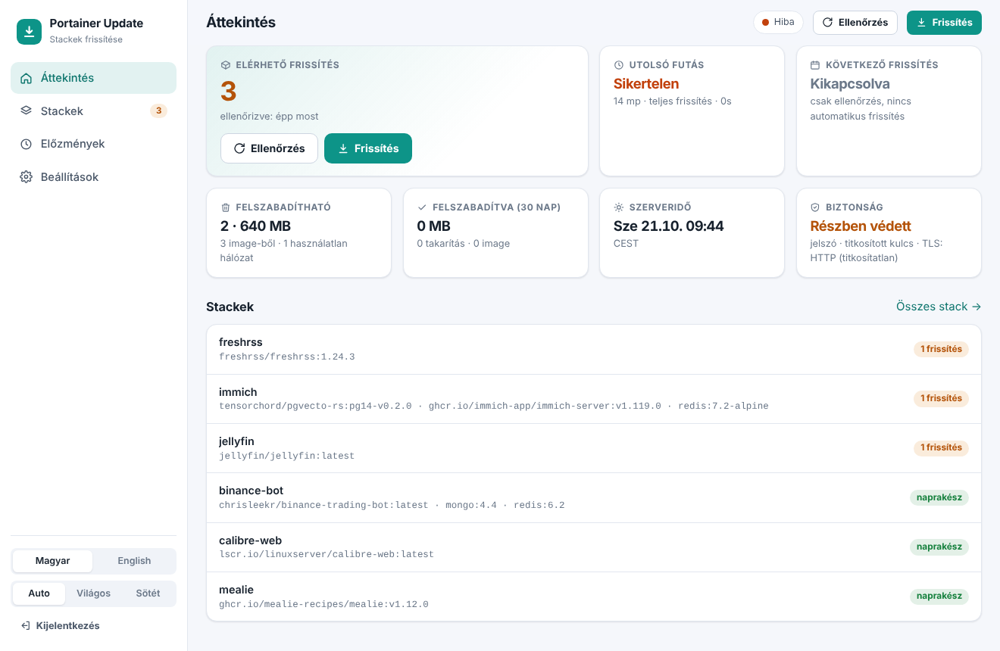
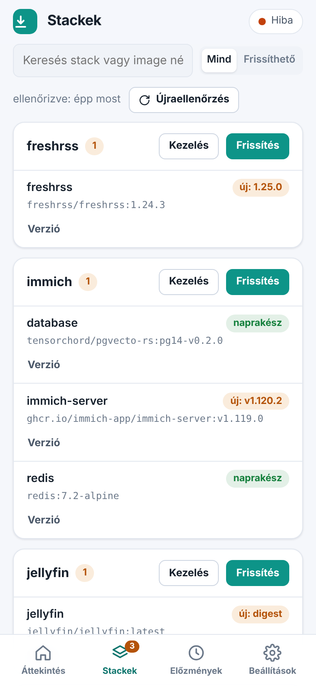
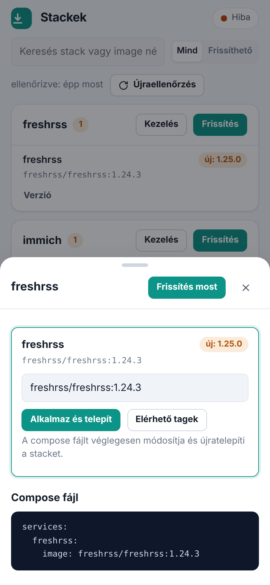

# Portainer Update Service – magyar, biztonságosabb változat

Webes felület a Portainer stackek frissítéséhez. Megmutatja, melyik image-hez jelent meg újabb verzió, és ütemezve vagy kézzel frissít. Minden futás előtt lementi a Portainert, egy service verzióját egy kattintással rögzítheted, egy elromlott frissítés után pedig visszaállhatsz.

Ez a [joshmadison/Portainer-Update-Service](https://github.com/joshmadison/Portainer-Update-Service) (MIT) forkja. Ami benne új:

- **Magyar és angol felület**, egy kattintással váltható (alapból magyar)
- **Mobilnézet**: alsó menüsor, kártyás stacklista, alulról felcsúszó panel
- **Világos és sötét téma**, alapból a rendszer beállítását követi
- **Kötelező bejelentkezés**: nem csak a módosításokhoz, hanem a megtekintéshez is jelszó kell
- **Titkosított titkok**: a Portainer API kulcs és a webhook URL titkosítva kerül a `config.yaml`-ba
- **TLS-tanúsítvány rögzítése** (pinning): a Portainer saját aláírású tanúsítványával és IP-címmel is működik
- **Kikapcsolható ütemező**: „csak jelez” mód, a frissítést te indítod
- **Értesítés új frissítésekről**, nem csak hibáról (pl. Home Assistant webhookra)
- **Előre megépített image** amd64-re és arm64-re (GHCR), a NAS-on nem kell semmit buildelni

<p align="center">
  
  
</p>
<p align="center">
  
  
</p>

---

## Telepítés Portainerrel

1. **Portainer → Stacks → Add stack → Web editor**, másold be ezt:

```yaml
services:
  update-service:
    image: ghcr.io/czdanika/portainerupdater:latest
    container_name: portainer-update-service
    restart: unless-stopped
    ports:
      - "8742:8090"            # NAS-port : konténer-port
    environment:
      TZ: "Europe/Budapest"
      # Opcionális: fix admin jelszó. Ha kihagyod, első indításkor a felületen kell megadni.
      # PUS_AUTH_TOKEN: "egy-hosszu-jelszo"
    volumes:
      - pus-data:/app/data     # állapot, előzmények, mentések, titkosító kulcs
      - pus-config:/app/config # beállítások (config.yaml)

volumes:
  pus-data:
  pus-config:
```

2. **Deploy the stack**, majd nyisd meg a `http://<nas-ip>:8742` címet.
3. Első indításkor **admin jelszót** kell létrehozni (legalább 8 karakter).
4. **Beállítások → Portainer kapcsolat**:
   - URL: `https://<nas-ip>:9443`
   - API kulcs: Portainer → *My account* → *Access tokens* → *Add access token*. Admin felhasználóval kell létrehozni.
5. **Beállítások → TLS tanúsítvány**: válaszd a *Tanúsítvány rögzítése* módot, nyomd meg a *Tanúsítvány lekérése* gombot, aztán az *Ezt rögzítem* gombot.
6. **Ütemezés**: az alapbeállítás *Kikapcsolva – csak jelez*. Ha automatikus frissítést szeretnél, válassz napot és időpontot. Előtte a törékeny service-eket (adatbázisok, Immich stb.) rögzítsd a *Verzió* gombbal.
7. **Mentés**. Az első ellenőrzés automatikusan elindul.

> A Docker socket **nincs** felcsatolva, és nem is kell. Az ellenőrzés, a mentés, a takarítás és az újratelepítés mind a Portainer API-n keresztül megy. Socket csak akkor kell, ha a Portainert is ezzel akarod frissíteni (*A Portainert is frissítse*), de ezt biztonsági okból nem ajánljuk.

### Frissítés

Az image a `main` ág minden változásakor újraépül. A P.U.S. a saját stackjét kihagyja a rendes futásokból. Frissíteni a **Beállítások → P.U.S. frissítése** gombbal lehet, vagy a Portainerben: *Stack → Update → Re-pull image*.

Ha egy konkrét verziót szeretnél használni, a `:latest` helyett írd be a kiadás címkéjét, például `:v1.0.0`.

---

## Biztonság

| Terület | Megoldás |
|---|---|
| Bejelentkezés | Minden `/api/*` hívás bejelentkezést kér. A munkamenet aláírt, `HttpOnly`, `SameSite=Strict` süti, alapból 30 napig érvényes. Szkriptekből `Authorization: Bearer <jelszó>` fejléccel is hívható. |
| Jelszó | A felületen megadott jelszó PBKDF2-hash-ként tárolódik. A `PUS_AUTH_TOKEN` környezeti változóval megadott jelszó soha nem kerül lemezre. Jelszócsere után a többi munkamenet érvénytelenné válik. |
| Brute force | 5 hibás próbálkozás után exponenciálisan növekvő várakozás következik (legfeljebb 15 perc). |
| CSRF | A módosító kéréseknél kötelező az azonos eredetű `Origin` és az `X-PUS-Request` fejléc. |
| Titkok | A `portainer_api_key` és a `notify_webhook` titkosítva tárolódik (`enc:v1:…`, Fernet/AES). A kulcs **másik kötetben** van (`/app/data/keys`), mint a `config.yaml` (`/app/config`). A régi, sima szöveges értékeket első mentéskor automatikusan titkosítja. A `config.yaml` jogosultsága `0600`. |
| Környezeti változók | `PUS_*` változóval megadott érték nem íródik a `config.yaml`-ba, és a felületen zárolva jelenik meg. |
| TLS | A tanúsítvány rögzítése (SHA-256 ujjlenyomat) saját aláírású tanúsítvánnyal és IP-címmel is működik. Ha a tanúsítvány megváltozik, a kapcsolat megszakad, és a felület jelzi. Az eredeti kódban volt egy hiba: `tls_verify: true` CA nélkül valójában *nem* ellenőrzött. Ez javítva van. |

További ajánlás: a felületet ne tedd ki az internetre. Elég belső hálón vagy VPN-en (pl. Tailscale) keresztül elérni.

### Titkosító kulcs

Alapból az első induláskor jön létre a `/app/data/keys/secret.key` fájlban. Ha a `pus-data` kötet elveszik, a mentett API kulcsot újra meg kell adni (a felület jelzi). A `PUS_SECRET_KEY` változóval fix kulcs is megadható.

---

## Környezeti változók

| Változó | Alapérték | Leírás |
|---|---|---|
| `PUS_AUTH_TOKEN` / `PUS_ADMIN_PASSWORD` | – | Fix admin jelszó. Ha meg van adva, a felületen nem módosítható. |
| `PUS_SECRET_KEY` | automatikus | A titkosító kulcs (tetszőleges szöveg). |
| `PUS_PORTAINER_URL` | – | Portainer címe (a felületen is megadható). |
| `PUS_PORTAINER_API_KEY` | – | Portainer API kulcs (a felületen is megadható). |
| `PUS_PORTAINER_ENDPOINT_ID` | automatikus | Portainer környezet azonosítója. |
| `PUS_TLS_FINGERPRINT` | – | A Portainer tanúsítványának SHA-256 ujjlenyomata. |
| `PUS_UPDATE_SCHEDULE_MODE` | `interval` | `off`, `daily`, `weekly` vagy `interval`. |
| `PUS_UPDATE_SCHEDULE_DAY` / `_TIME` | `0` / `03:30` | Nap (0 = hétfő) és időpont. |
| `PUS_UPDATE_INTERVAL_HOURS` | `168` | `interval` módban a frissítések közti idő. |
| `PUS_CHECK_INTERVAL_HOURS` | `12` | Milyen gyakran ellenőrizze a registryt. |
| `PUS_NOTIFY_WEBHOOK` | – | Értesítési URL (JSON POST). |
| `PUS_NOTIFY_ON_UPDATES` | `false` | Új frissítésnél is küldjön értesítést. |
| `PUS_MAX_PARALLEL_DEPLOYS` | `3` | Egyszerre hány stack települjön újra. |
| `PUS_KEEP_BACKUPS` | `5` | Ennyi Portainer-mentést tart meg. |
| `PUS_SESSION_DAYS` | `30` | A bejelentkezés érvényessége napokban. |
| `PUS_COOKIE_SECURE` | `false` | `true`, ha a felület csak HTTPS-en érhető el (reverse proxy mögött). |
| `TZ` | `UTC` | Időzóna az ütemezéshez. |

### Webhook formátum

```json
{"event": "updates_available", "title": "3 container update(s) available", "count": 3,
 "updates": [{"stack": "immich", "service": "immich-server", "image": "…:v1.119.0", "latest": "v1.120.2"}]}
```

```json
{"event": "update_failed", "title": "Portainer update run FAILED", "run_id": "…", "steps": […]}
```

Home Assistantban egy **Webhook** triggerű automatizáció fogadja: `https://<ha>/api/webhook/<id>`. A `{{ trigger.json.title }}` sablonnal továbbküldhető push értesítésként.

---

## Fejlesztés

```bash
pip install -r requirements.txt pytest pytest-timeout
python -m pytest tests -q
PUS_LISTEN_HOST=127.0.0.1 python run.py   # http://127.0.0.1:8090
```

## Licenc

MIT. Az eredeti szerző: Josh Madison ([upstream README](docs/UPSTREAM_README.md)). A módosítások ugyanezen licenc alatt érhetők el.
